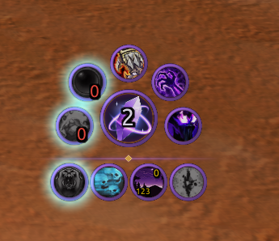
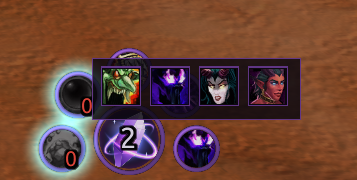
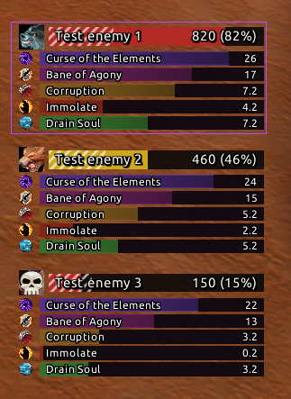
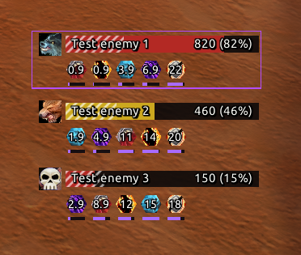
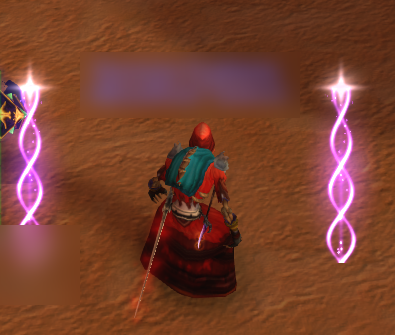
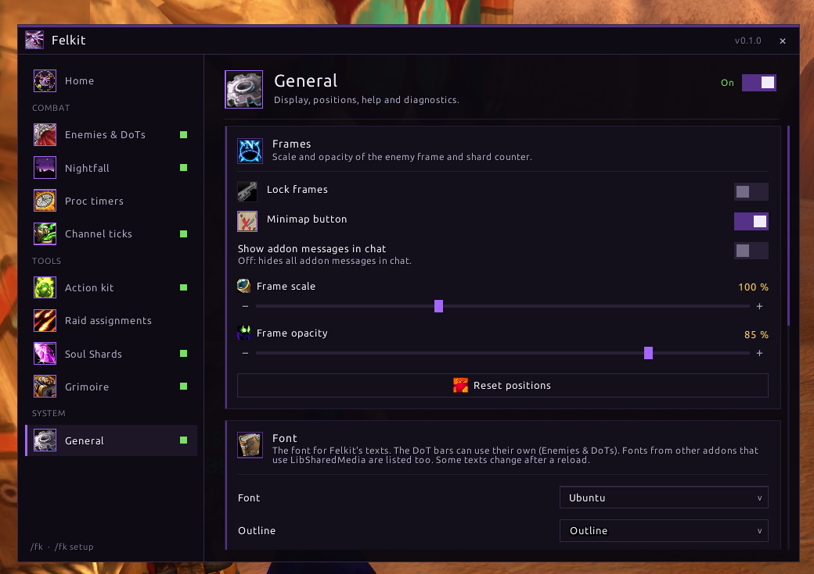

# Felkit

A warlock toolkit for WoW Forever (Interface 16001). Felkit puts your shards, stones, demons, curses and DoT timers in one place, with proc alerts and raid assignments on top.

## Install

Copy the `Felkit` folder (the one with `Felkit.toc`) into `World of Warcraft\_forever_\Interface\AddOns`, then restart the game. Type `/fk` to open the settings.

## Features

### Action kit

A ring of buttons around your soul shard counter. The orb in the middle shows how many shards you carry. Around it sit your healthstone and soulstone, your curses, your demon and your ward. Smaller buttons hold sacrifice, link and domination, and the bottom row holds your armor, weapon stone, Drain Soul, summons and utility spells.

- Buttons with several choices, like demons, open a flyout with the other spells.
- The healthstone and soulstone buttons glow when you have none, so you remember to make them.
- The size, spacing, ring colors and centre crystal are all adjustable. Other layouts are available too: a row, a column, a circle, a grid or free placement.

### Enemies & DoTs

A window listing every enemy in combat with you or your group, each with a health bar and your DoTs on it. The timers are drawn by the game itself, so they keep working in combat. Click a row to target that enemy.

Three styles:

- **Kit bars:** one bar per DoT under each enemy, in a fixed order and colored by spell.
- **Equal bars:** the same bars in a single color, sorted by which runs out first.
- **Warlock HUD:** compact icons with a countdown, beside or under the health bar. Icons can be square, rounded, round, diamond or hexagon, with a colored border and a small time bar.

The health bars also show **Does It Die**: a marker for how much health your running DoTs will still take off, so you can tell whether a mob will die without another cast. Bar textures and fonts can be changed, including those from other addons that use LibSharedMedia.

  
  

### Nightfall

When Shadow Trance procs, violet bars flare up on both sides of your character and a louder sound plays, so you don't miss a free Shadow Bolt.

### Proc timers

Movable timers for Decimation and Nightfall, shown as a bar or an icon with the time left. Use `/fk procs test` to place them.

### Channel ticks

Tick marks on the game's channel bar, so you can see when each tick of Drain Soul, Drain Life and other channels lands.

### Raid assignments

The raid leader or an assistant picks a curse, a crowd control spell with its raid mark, and a soulstone target for each warlock, then syncs. Warlocks running Felkit get their assignments as buttons over their orb; everyone else can get them as a chat announcement. Open it with `/fk assign`.

### Soul Shards

Keeps your shard count under a maximum you choose and cleans up extra shards automatically.

### Grimoire

A catalogue of your warlock spells with details, and richer spell tooltips.

### Settings

Every module can be turned on or off and tuned from one window. Each page has a live preview where it helps.

## Commands

- `/fk` or `/felkit`: open the settings.
- `/fk style hud|equal|kit`: switch the DoT timer style.
- `/fk procs test`: show the proc timers so you can move them.
- `/fk assign`: open the raid assignments window.

## Credits

Felkit is a fork of Warlock All-in-One by Vitam. MIT licensed, see [LICENSE](LICENSE); credits and third-party licenses are in [NOTICE.md](NOTICE.md).
